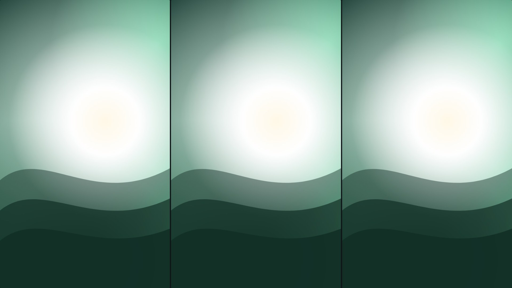
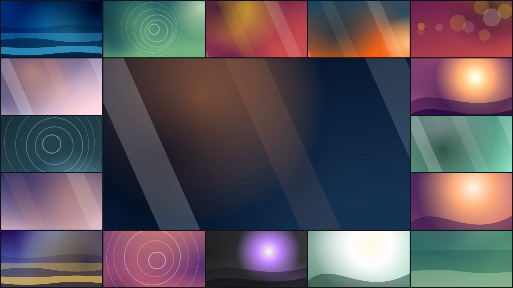
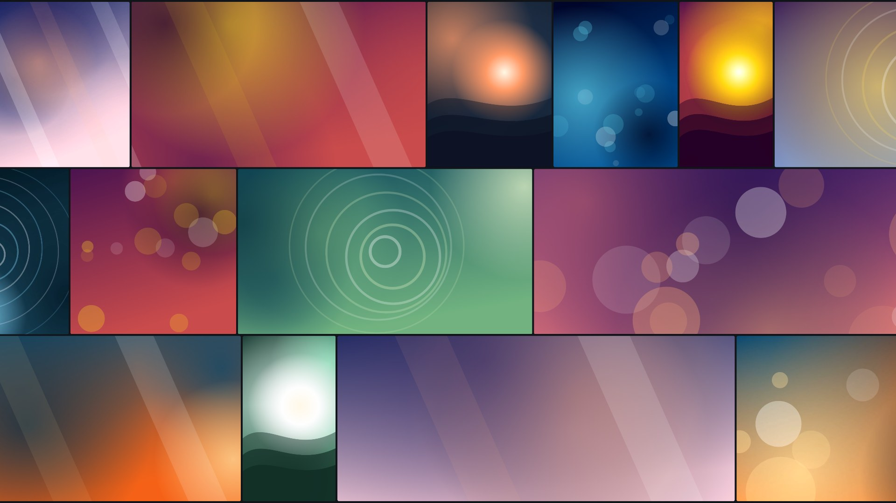
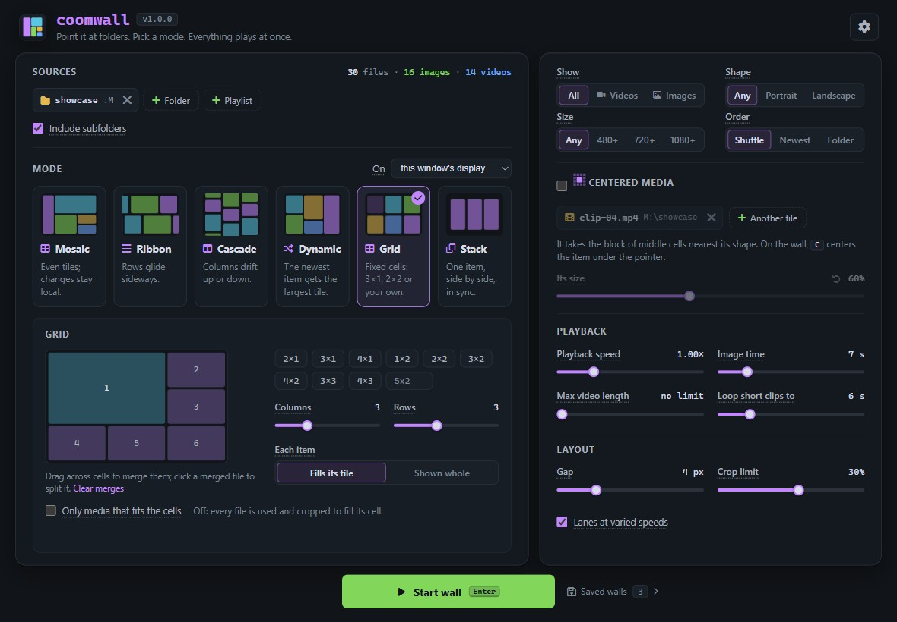
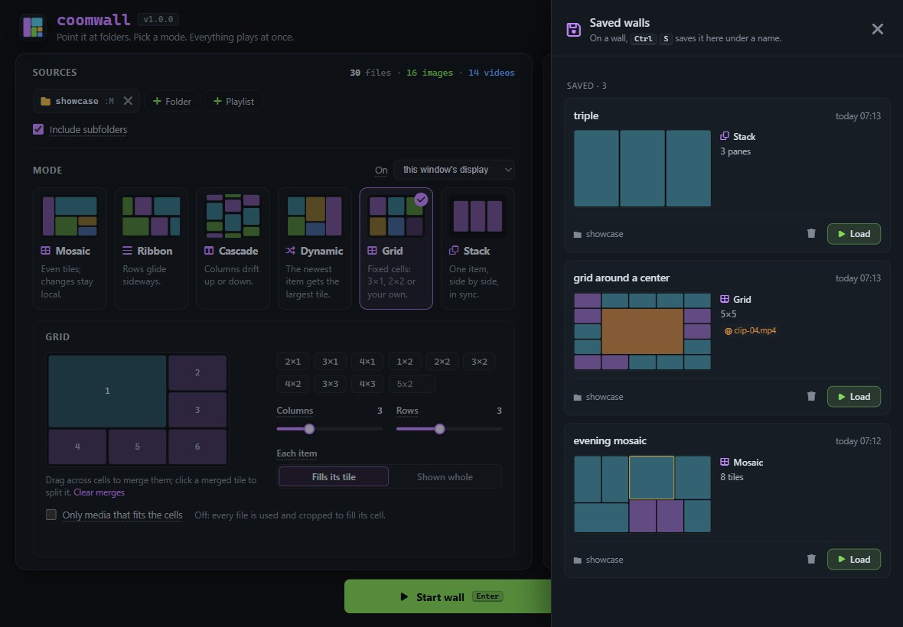

<div align="center">


# coomwall

**Point it at folders of images and videos. Pick a mode. Everything plays at once, on every screen.**

<a href="https://github.com/kpg-anon/coomwall/releases/latest"></a>


**[Download](https://github.com/kpg-anon/coomwall/releases/latest)** (installer or portable zip) · [Usage](USAGE.md) · [Changelog](CHANGELOG.md)

</div>

https://github.com/user-attachments/assets/8cc377f5-61e9-435d-beea-2c87c729c7bd

---

## What it is

`coomwall` fills a monitor (or each of several) with your media: images, GIFs and videos of any size and shape, all on one surface, all playing at once. It is a desktop app (Tauri v2 + Svelte + Rust), with no command line to learn.

It is the GUI successor to [`coomplexer grid --mix`](https://github.com/kpg-anon/coomplexer). That tool tiled one mpv window per screen region, so a tile could never move or resize while it played, every tile had to be 9:16 or 16:9, and finished tiles froze until their neighbors caught up. Here every tile is a rectangle on one GPU-composited surface, so the layout can change smoothly while everything keeps playing.

## Modes

| Mode | What it does |
| --- | --- |
| **Mosaic** | A fixed number of tiles (1–16) of about one size, filling the screen. When a tile's item ends, the next one takes its place, and the layout changes only as much as it has to. The tile you are watching never moves. See [How Mosaic stays still](USAGE.md#how-mosaic-stays-still). |
| **Ribbon** | Rows that travel left (or right) at a constant speed. Every item keeps its own shape along the row, so nothing is cropped. |
| **Cascade** | Columns that travel up (or down), like a slow feed. |
| **Dynamic** | On a clock (every 1.5–15 s) a new item arrives and the whole wall is laid out again. Tiles are not one size: the newest item gets the largest tile, the next few are in between, and tiles shrink as they age. **Focus** sets how strong that is; at 0 all tiles are alike. |
| **Grid** | Equal cells that never move, like `coomplexer grid -g 3x1`: pick 2×1, 3×1, 2×2 …, type `5x2`, or merge cells into larger tiles yourself. Items either fill their tile or are shown whole. See [Grid layouts](USAGE.md#grid-layouts). |
| **Stack** | One item repeated in 1–6 panes side by side or one above the next, like `coomplexer stack`: every pane shows the same frame. It plays your sources one after another, or one file or link that loops. A link (YouTube and any site yt-dlp knows) is streamed straight from the site or downloaded first. See [Stack](USAGE.md#stack). |

You can switch modes from the wall with `1`–`6`. The order carries on where it was.

<p align="center"></p>

<p align="center"></p>

<table>
<tr>
<td></td>
<td></td>
</tr>
<tr>
<td align="center">Grid 5×5 with centered media</td>
<td align="center">Ribbon, three rows</td>
</tr>
</table>

Any mode can also have **centered media**: one file that plays in the middle at its own shape and never moves. It is always part of the wall, never on top of it: the other media fill the screen around it with no gaps. See [Centered media](USAGE.md#centered-media).

## Using it

<p align="center"></p>

1. **Add sources.** Drop folders or `.m3u` playlists on the window, or click to choose. Subfolders are included unless you turn that off. Hidden folders such as comfysort's `.trash` are skipped.
2. **Pick what to show:** everything, videos only or images only, any shape, portrait only or landscape only.
3. **Pick a mode** and its numbers. The right-hand column has **Centered media**, size and order filters, and playback settings.
4. **Start the wall** with `Enter`. It goes fullscreen on the display you chose, or opens in a window with **Run the wall in a window** (Preferences → General). `Esc` comes back.

### On the wall

The controls appear while the pointer moves and hide after 2.2 s; otherwise the screen is media only. Keys act on the item under the pointer. The video under the pointer shows a seek line along its bottom edge; click or drag on it to jump.

| Key | Does |
| --- | --- |
| `Space` | pause or resume |
| `1`–`6` | Mosaic · Ribbon · Cascade · Dynamic · Grid · Stack |
| `+` `−` | one more or one fewer tile, row, column or Stack pane |
| `N` · `B` | next item in this tile · the item it showed before |
| `P` | pin it: it keeps playing and nothing moves it |
| `M` | sound on or off for this item |
| `F11` | in a window, or fullscreen |
| `F`, double-click | view it whole, with zoom and pan |
| `C` | play it in the center |
| right-click | Show in Explorer, open, center, stack, remove, never show again |
| `Ctrl` `S` | save the wall under a name |
| `?` | all keys |
| `Esc` | back to setup |

Every key is listed in [USAGE.md](USAGE.md#keys-on-the-wall).

### A wall on each display

With more than one display, tick **A wall on each display** next to Mode. Each display gets its own mode, numbers and filters, and can have its own folders. `Enter` opens every wall at once; `Ctrl`+`Shift`+arrow moves a wall to the next display while its media keeps playing. See [A wall on each display](USAGE.md#a-wall-on-each-display).

<p align="center"></p>
<p align="center"><sub>Illustration: three displays, each with its own mode.</sub></p>

### Saved walls

A running wall saves itself every 10 seconds. **Resume**, beside Start, opens the last wall again with the same files in the same tiles, and each video from where it was. `Ctrl`+`S` saves a wall under a name; **Saved walls** lists every save with a drawing of its tiles. See [Resuming a wall](USAGE.md#resuming-a-wall).

<p align="center"></p>

### Preferences

The cog at the top right opens **Preferences**: theme, what happens under the pointer, automatic pausing, keys, Grid fit, graphics adapter, color, yt-dlp cookies and updates. Hovering a setting's name shows what it does, and every setting is remembered.

<p align="center"></p>

## Install

Each [release](https://github.com/kpg-anon/coomwall/releases/latest) has three downloads for Windows 10 and 11 (x64):

| File | What it is |
|:--|:--|
| `coomwall_<version>_x64-setup.exe` | **Recommended.** Installs for your user account, with a Start menu entry and an uninstaller. This is the one that updates itself: coomwall offers each new release and installs it in one click. |
| `coomwall_<version>_x64-portable.zip` | No install. Unzip it anywhere and run `coomwall.exe`. Settings, saved walls and the cache stay in the `coomwall-data` folder next to it. It does not update itself; see [Updating](#updating). |
| `coomwall_<version>_x64_en-US.msi` | For managed or silent installs (`msiexec /i … /qn`). Installs for all users. For automatic updates use `setup.exe` instead: the in-app updater runs the `setup.exe` installer. |

If you want coomwall to stay up to date without thinking about it, use `setup.exe`.

The WebView2 runtime coomwall needs is part of Windows 11 and current Windows 10. The installers download it if it is missing; the portable zip cannot, so on a system without it install it from [Microsoft](https://developer.microsoft.com/microsoft-edge/webview2/) first. The downloads are not code-signed, so SmartScreen may ask once (More info → Run anyway).

For links (Stack, and page links in playlists): [yt-dlp](https://github.com/yt-dlp/yt-dlp) on PATH (`winget install yt-dlp`), and ffmpeg for downloads above 360p.

### Formats

Playback is the system WebView's (Chromium on Windows). These work:

- MP4, WebM, MOV and MKV with H.264, VP9 or AV1
- JPG, PNG, WebP, AVIF, GIF and BMP

HEVC plays only when Windows has a working HEVC decoder (the HEVC Video Extensions). Files that cannot be decoded are skipped, and the HUD counts them.

### Updating

coomwall checks for a newer release when it starts (Preferences → General → **Check for updates when coomwall starts**). When there is one, a notice shows its changelog; **Update now** downloads it, installs it and restarts. Your settings and saved walls are kept.

The portable copy shows the same notice with **Download zip** instead. To update it, replace `coomwall.exe` and `WebView2Loader.dll` with the ones from the new zip and keep the `coomwall-data` folder.

## Build from source

Requirements: Node 20+, Rust stable, and on Windows the WebView2 runtime (already part of Windows 11). For links in Stack and in playlists: yt-dlp on PATH, and ffmpeg for downloads.

```console
npm install
npm run tauri dev       # run it
npm run tauri build     # installer in target/release/bundle
cargo test -p coomwall-engine   # solver, scanner, cache and Range-header tests
```

Notes for the windows-gnu toolchain and the source layout are in [USAGE.md](USAGE.md#building-from-source).

## Documentation

| | |
|---|---|
| **[USAGE.md](USAGE.md)** | every setting and key, Grid, Stack, centered media, multiple displays, saved walls, graphics adapter and color, and how Mosaic and Dynamic are laid out |
| **[CHANGELOG.md](CHANGELOG.md)** | what changed in each release |

## License

**[MIT](LICENSE)** — © 2026 kpg-anon.
