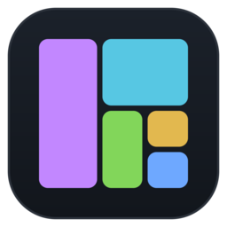

<div align="center">



# coomwall

**Point it at folders of images and videos. Pick a mode. Everything plays at once, on one screen.**

</div>

---

## What it is

`coomwall` fills a monitor (or each of several) with your media: images, GIFs and videos of any size and shape, all on one surface, all playing at once. It is a desktop app (Tauri v2 + Svelte + Rust), with no command line to learn.

It is the GUI successor to `coomplexer grid --mix`. That tool tiled one mpv window per screen region, so a tile could never move or resize while it played, every tile had to be 9:16 or 16:9, and finished tiles froze until their neighbours caught up. Here every tile is a rectangle on one GPU-composited surface, so the layout can change smoothly while everything keeps playing.

## Modes

| Mode | What it does |
| --- | --- |
| **Mosaic** | A fixed number of tiles (1–16) of about one size, filling the screen. When a tile's item ends, the next one takes its place, and the layout changes only as much as it has to. See [How Mosaic stays still](#how-mosaic-stays-still). |
| **Ribbon** | Rows that travel left (or right) at a constant speed. Every item keeps its own shape along the row, so nothing is cropped. |
| **Cascade** | Columns that travel up (or down), like a slow feed. |
| **Dynamic** | On a clock (every 1.5–15 s) a new item arrives and the whole wall is laid out again. Tiles are not one size: the newest item gets the largest tile, the next few are in between, and tiles shrink as they age. **Focus** sets how strong that is; at 0 all tiles are alike. |
| **Grid** | Equal cells that never move, like `coomplexer grid -g 3x1`: pick 2×1, 3×1, 2×2 …, type `5x2`, or merge cells into larger tiles yourself. Items either fill their tile or are shown whole. |
| **Centre** | One file you choose plays in the middle at its own shape and never moves. The other tiles are arranged around it and change the way Mosaic's do. |

You can switch modes from the wall with `1`–`6`. The shuffle carries on where it was.

## Using it

1. **Add sources.** Drop folders or `.m3u` playlists on the window, or click to choose. Subfolders are included unless you turn that off. Hidden folders such as comfysort's `.trash` are skipped.
2. **Pick a mode** and its numbers: tiles and stillness for Mosaic, rows or columns plus direction and speed for the feeds, the layout for Grid, the file and its size for Centre.
3. **Pick what to show:** everything, videos only or images only, and any shape, portrait only or landscape only.
4. **Start the wall** with `Enter`. It goes fullscreen on the display you chose. `Esc` comes back.

### Grid layouts

Under the Grid card: one-click presets (columns × rows), a box that takes `5x2`, sliders for columns (1–8) and rows (1–6), and a drawing of the grid. Drag across cells in the drawing to merge them into one tile; click a merged tile to split it. On the wall, `+` `−` change the columns and `↑` `↓` the rows.

### Centre

Choose the file under the Centre card, or start without one and on the wall press `C` on any item (or right-click → **Play in the centre**). `+` `−` change how many tiles are around it, `↑` `↓` its size.

The size you set is the largest it will be. With few tiles around it, a centre that large can leave strips no tile fits without heavy cropping; then the layout uses a smaller centre, or one that reaches two edges of the screen. The centre itself is cropped only as a last resort.

### One item, whole

`F` or a double-click opens the item under the pointer uncropped. A video carries on from where its tile was.

| In the viewer | Does |
| --- | --- |
| wheel | zoom toward the pointer (up to 16×) |
| drag | pan |
| double-click | zoom in at that point, or back to fit |
| `Z` · `0` | actual size (one media pixel per screen pixel) · fit |
| `+` `−` | zoom in and out |
| `Space`, click | play or pause this video (the wall is not affected) |
| `←` `→` | 5 s back or forward (`Shift`: 1 s) |
| `,` `.` | one frame back or forward while paused |
| `↑` `↓` | volume |
| `M` | sound on or off |
| `R` · `X` | turn a quarter · mirror |
| `Esc`, `F`, click outside | close |

### A wall on each display

With more than one display, tick **A wall on each display** next to Mode. A small map shows your displays as Windows arranges them. Click one, then pick its mode and numbers below; untick **Wall on this display** to leave it free. Each display remembers its own mode and that mode's numbers, and what it shows (Show and Shape), so one display can play videos in a grid while another runs a Mosaic of images.

Tick **Its own folders** to give a display its own folders and playlists instead of the shared sources. A display without its own plays the shared ones. Everything under More options is shared.

`Enter` opens every wall at once and the setup window steps aside. On the walls:

- Keys go to the wall under the pointer.
- `Space` pauses or resumes that wall. `Shift`+`Space` does it for all of them.
- `M` moves the one item with sound to the wall you are on.
- `Ctrl`+`Shift`+arrow moves the wall to the display on that side. If that display has a wall, the two swap; their media keeps playing and each display keeps the layout that moved onto it.
- `Esc` on any wall closes all of them. Closing one with `Alt+F4` leaves the others running; setup comes back when the last one closes.
- Each wall shuffles on its own, so with a small folder the same file can appear on two displays at once.

### Walls and other windows

A wall is an ordinary fullscreen window. Bring another program to the front (a global hotkey, `Alt+Tab`, the taskbar) and it stays in front; moving the pointer over a wall does not bring the wall back. Click a wall to return to it.

If you want the walls above everything else, turn on **More options → Keep the wall above other windows**, or press `T` on a wall.

### Right-click on an item

**Show in Explorer**, **Open in default app**, **Play in the centre**, **Remove from wall** (gone until you go back to setup) and **Never show again**. Never show again saves the file to a list that scanning skips; setup shows how many files are hidden, and you can unhide them one by one or all at once.

Everything else (image duration, a video length cap, looping short clips, playback speed, gap, crop limit, what happens under the pointer, when the wall pauses by itself, on top, display, graphics adapter, colour, theme) is under **More options**. Every setting is remembered.

### Keys on the wall

| Key | Does |
| --- | --- |
| `Space` | pause or resume this wall · with `Shift`, every wall |
| `1`–`6` | Mosaic · Ribbon · Cascade · Dynamic · Grid · Centre |
| `+` `−` | one more or one fewer tile, row or column |
| `↑` `↓` | feed speed · Dynamic: how often · Grid: rows · Centre: its size |
| `D` | reverse the feed's direction |
| `[` `]` | playback speed by 5% (`Shift` for 25%), from 25% to 300% |
| `N` | next item in the tile under the pointer |
| `P` | pin it: it keeps playing, and no other change moves it |
| `M` | sound on for the item under the pointer (only one item has sound) |
| `F`, double-click | view it whole: zoom and pan |
| `C` | play it in the centre, with the other tiles around it |
| `O` | show the file in Explorer |
| right-click | Show in Explorer · Open in default app · Play in the centre · Remove from wall · Never show again |
| `T` | keep the walls above every other window, or stop |
| `Ctrl` `Shift` `←` `→` `↑` `↓` | move this wall to the display on that side; a wall there swaps with it |
| `R` | lay the wall out again · Grid: new items · feeds: refill |
| `G` | outline each Mosaic change as it happens |
| `?` | all keys |
| `Esc` | back to setup |

The interface only appears while the pointer moves, and hides again after 2.2 s (**More options → Controls hide after**, 0.5–10 s). Otherwise the screen is media only.

## How Mosaic stays still

The rule is that **the thing you are looking at must not jump.**

- **The layout is a slicing tree that stores its cuts.** Each split remembers where its cut falls instead of deriving it from what is inside. So one block of the wall can be rebuilt while every tile outside that block keeps its exact pixels.
- **Smallest change first.** When a tile ends, the solver tries the cheapest option first: put the next item in the same tile with no movement at all. Only if that would crop the item too much does it try re-laying out the tile's parent block, then the grandparent, and so on up to 8 tiles. Each block is solved exactly by dynamic programming over the block's items, for that block's fixed rectangle.
- **Fit-aware queue.** It looks at the next 10 queued items and prefers one whose shape fits the empty slot. An item can be passed over at most 6 times before it is placed anyway, but never into the tile you are watching.
- **Every option is scored.** Each candidate layout is scored on crop, size spread, and motion. Motion is how far tiles already on screen would move or resize, measured in tile sizes, and weighted by the **Stillness** setting. A tile that changed or moved in the last 5 s counts three times, and a pinned tile counts twelve times.
- **The tile under the pointer is frozen.** No other change may move it. When its own item ends, the item plays again (up to twice) and is then replaced in place with the best-fitting item in the queue.
- **Changes are spaced out.** A change that moves tiles gets its full 0.7 s transition before the next one starts. For 3 s after any move, motion costs four times as much, so the next few changes are content swaps unless a swap would crop badly. Content changes cross-fade only after the new item's first frame is decoded, so a tile never shows an empty frame.
- **Whole-wall re-layouts are rare.** A re-layout of every tile is used at most once a minute, and only when no smaller block can take any queued item within the crop limit. A crop past the limit for a few seconds is easier to watch than every tile moving. `R` re-lays out the whole wall on demand.

In the engine's 3,000-change test on a 9-tile wall of mixed shapes:

- 88% of changes were pure content swaps.
- On average 0.18 tiles moved per change.
- No tile ever had more than 30% of its media cropped.
- Each decision took about 8 ms.

## How Dynamic and Centre are laid out

Both use the same solver as Mosaic, with two additions.

- **Target areas (Dynamic).** Every tile has a weight, its target area relative to the others. The search keeps, for each candidate block, the smallest and largest `area ÷ weight` among its tiles; the ratio of the two is how far the worst-served tiles are from their targets, and it is scored the way Mosaic scores uneven sizes. With every weight 1 this is exactly Mosaic's score. Dynamic gives the newest tile up to 4.5, the next quarter of the tiles up to 2.3, and the rest 1. In the engine's test a tile asked to be 4× the others comes out 2.9× to 4.4× on walls of 5 to 16 tiles, within the crop limit.
- **A fixed centre (Centre).** The wall is a frame: the centre tile, and up to four strips around it (left, right, top, bottom), each one block of the slicing tree. Several centre sizes at and below the size you asked for are tried, in both frames (side strips the full height, or top and bottom strips the full width). For each, items are shared out among the strips and then moved or swapped between strips while the total score falls; the cheapest wall wins. Afterwards the centre is frozen, and since a block holding a frozen tile is never re-solved, every later change stays inside one strip. In the engine's test (150 walls, 4–16 tiles around) the centre kept its own shape every time and tiles around it were cropped 7% on average.

## Colour

WebView2 (Chromium) converts every colour to the display's colour profile. On a wide-gamut display that changes the numbers sent to the panel: measured on a P3-class laptop panel, sRGB red (255, 0, 0) went out as (212, 51, 33). That is what colour management is meant to do, but mpv and most image viewers do not do it, so the same file looks less saturated in a colour-managed window than beside them.

**More options → Colour** chooses:

- **As in the file** (default): the display is treated as sRGB and values go out unchanged, as in mpv. Passed to WebView2 as `--force-color-profile=srgb`.
- **Converted to the display's colour profile**: Chromium's default behaviour.

A change needs a restart; the setup screen offers one. On an sRGB display the two are the same.

## Install / build

Requirements: Node 20+, Rust stable, and on Windows the WebView2 runtime (already part of Windows 11).

```console
npm install
npm run tauri dev       # run it
npm run tauri build     # installer in target/release/bundle
cargo test -p coomwall-engine   # solver, scanner, cache and Range-header tests
```

On the windows-gnu toolchain the first `tauri build` needs `WebView2Loader.dll` in `target/release` before it has built it. After one `tauri dev`, copy it over: `cp target/debug/WebView2Loader.dll target/release/`.

### Graphics adapter

**More options → Graphics** picks the GPU that decodes and composites everything: the Windows default (for WebView2 that is the power-saving one), High performance or Power saving. It is passed to WebView2 as `--use-adapter-luid`, so a change needs a restart; the setup screen offers one.

On a hybrid laptop the displays are wired to the integrated GPU, and with High performance every frame is copied across to it. Measured on an XPS 17 9730 (Iris Xe + RTX 4070 Laptop), Ribbon with 4 rows of 1080p60 clips:

| Wall on | Windows default (Iris Xe) | High performance (RTX 4070) |
| --- | --- | --- |
| 1920×1200 external monitor | 36% of frames dropped, 34 fps | 6% dropped, 59 fps |
| 3840×2400 built-in panel | 37% dropped, 35 fps | videos played at about 5% speed |

With High performance, a Ribbon of 4 rows on that panel stops most videos on one frame: the RTX copy engine runs at 77% and Chromium logs `DECODER_UNDERFLOW` without an error. On Windows default the same wall plays (Iris Xe decode 31%). The wall now notices: when several visible videos have had no new frame for 4 s, the HUD says how many and points to the Graphics setting.

### Formats

Playback is the system WebView's (Chromium on Windows). These work:

- MP4, WebM, MOV and MKV with H.264, VP9 or AV1
- JPG, PNG, WebP, AVIF, GIF and BMP

HEVC plays only when Windows has a working HEVC decoder (the HEVC Video Extensions). Files that cannot be decoded are skipped, and the HUD counts them.

## Layout

```
crates/engine/      pure Rust: scan.rs (folders, playlists), cache.rs (known dimensions),
                    layout.rs (the Mosaic solver and its tests), patch.rs (settings merge)
src-tauri/          Tauri shell: commands.rs (IPC), media.rs (the cw:// file server
                    with HTTP Range support, so large videos seek without loading whole),
                    walls.rs (one window per display), gpu.rs (adapter choice)
src/lib/            Svelte 5 frontend: queue, the Mosaic / Dynamic / Centre controller
                    (mosaic.svelte.ts), Grid (grid.ts, grid.svelte.ts), feeds, components
```

## License

MIT
