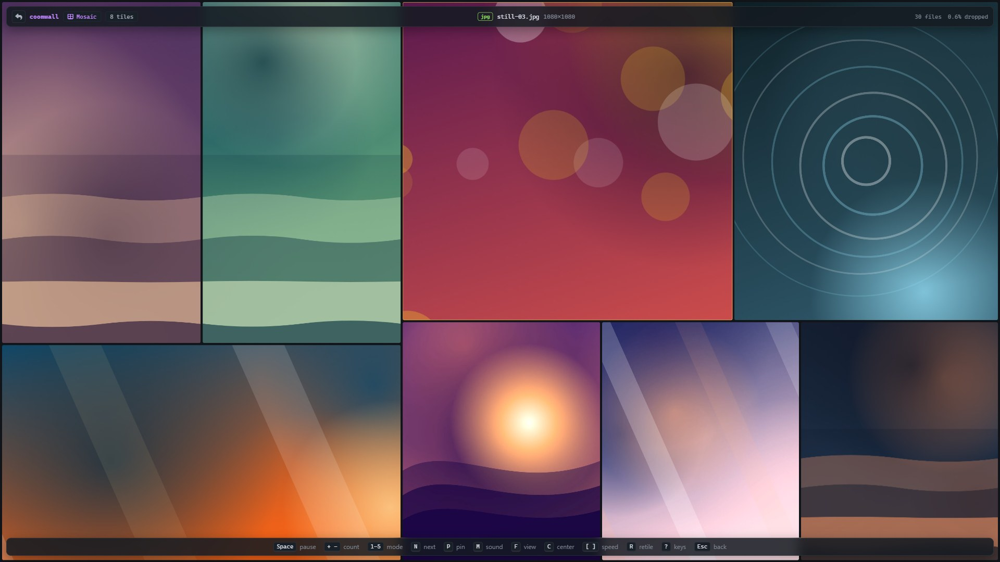
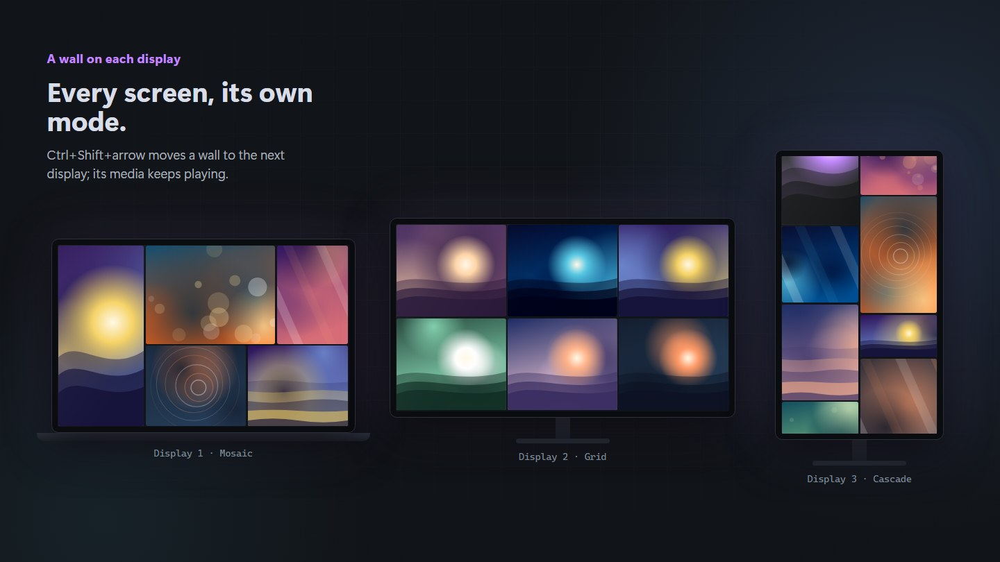
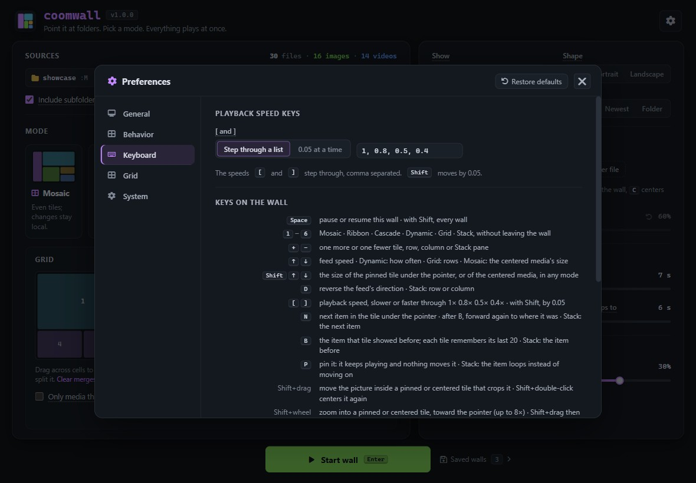

<div align="center">


# coomwall

**Point it at folders of images and videos. Pick a mode. Everything plays at once, on every screen.**

<a href="https://github.com/kpg-anon/coomwall/releases/latest"></a>


**[Download the installer](https://github.com/kpg-anon/coomwall/releases/latest)** · [Changelog](CHANGELOG.md)

</div>

https://github.com/user-attachments/assets/8cc377f5-61e9-435d-beea-2c87c729c7bd

---

## What it is

`coomwall` fills a monitor (or each of several) with your media: images, GIFs and videos of any size and shape, all on one surface, all playing at once. It is a desktop app (Tauri v2 + Svelte + Rust), with no command line to learn.

It is the GUI successor to `coomplexer grid --mix`. That tool tiled one mpv window per screen region, so a tile could never move or resize while it played, every tile had to be 9:16 or 16:9, and finished tiles froze until their neighbors caught up. Here every tile is a rectangle on one GPU-composited surface, so the layout can change smoothly while everything keeps playing.

## Modes

| Mode | What it does |
| --- | --- |
| **Mosaic** | A fixed number of tiles (1–16) of about one size, filling the screen. When a tile's item ends, the next one takes its place, and the layout changes only as much as it has to. See [How Mosaic stays still](#how-mosaic-stays-still). |
| **Ribbon** | Rows that travel left (or right) at a constant speed. Every item keeps its own shape along the row, so nothing is cropped. |
| **Cascade** | Columns that travel up (or down), like a slow feed. |
| **Dynamic** | On a clock (every 1.5–15 s) a new item arrives and the whole wall is laid out again. Tiles are not one size: the newest item gets the largest tile, the next few are in between, and tiles shrink as they age. **Focus** sets how strong that is; at 0 all tiles are alike. |
| **Grid** | Equal cells that never move, like `coomplexer grid -g 3x1`: pick 2×1, 3×1, 2×2 …, type `5x2`, or merge cells into larger tiles yourself. Items either fill their tile or are shown whole. |
| **Stack** | One item repeated in 1–6 panes side by side or one above the next, like `coomplexer stack`: every pane shows the same frame. It plays your sources one after another, or one file or link that loops. A link (YouTube and any site yt-dlp knows) is streamed straight from the site or downloaded first. See [Stack](#stack). |

You can switch modes from the wall with `1`–`6`. The order carries on where it was.

<p align="center"></p>

<p align="center"></p>

<table>
<tr>
<td></td>
<td></td>
</tr>
<tr>
<td align="center">Grid 5×5 with centered media</td>
<td align="center">Ribbon, three rows</td>
</tr>
</table>

Any mode can also have **centered media**: one file that plays in the middle at its own shape and never moves. It is always part of the wall, never on top of it: the other media fill the screen around it with no gaps. See [Centered media](#centered-media).

## Using it

<p align="center"></p>

1. **Add sources.** Drop folders or `.m3u` playlists on the window, or click to choose. Subfolders are included unless you turn that off. Hidden folders such as comfysort's `.trash` are skipped.
2. **Pick what to show** (next to the sources): everything, videos only or images only, and any shape, portrait only or landscape only.
3. **Pick a mode** and its numbers: tiles and stillness for Mosaic, rows or columns plus direction and speed for the feeds, the layout for Grid, panes and a file or link for Stack. In the right-hand column, turn on **Centered media** and choose its file and size if you want one. What to show is at the top of that column: **Show** (videos, images or both), **Shape** (portrait or landscape only), **Size** (skip files whose shorter side is under 480, 720 or 1080 px) and **Order** (shuffle, newest first by file date, or folder order).
4. **Start the wall** with `Enter`. It goes fullscreen on the display you chose. `Esc` comes back.

### Grid layouts

Under the Grid card: one-click presets (columns × rows), a box that takes `5x2`, sliders for columns (1–8) and rows (1–6), and a drawing of the grid. Drag across cells in the drawing to merge them into one tile; click a merged tile to split it. On the wall, `+` `−` change the columns and `↑` `↓` the rows.

**Only media that fits the cells** (with "Fills its tile") uses only files whose shape fits the cells, so nothing is cut off more than a little. How close is a preference (cog → Grid): **Automatic** (exact shape on a 16:9 screen, up to 12% cut on any other), **Exact shape**, or **Up to 12% cut**. On a 16:9 screen a 3×3 grid has 16:9 cells, so 16:9 video fits exactly; on a 16:10 screen the cells are 1.6:1 and 16:9 video loses about 10%. Setup shows how many of your files fit before you start; if none do, the wall says so. Mosaic's **Crop limit** does not apply to Grid.

### Stack

One item in 1–6 panes (`+` `−` on the wall). The item is decoded once and every pane is drawn from it, so the copies never drift apart.

- **Direction:** a row, a column, or Auto (whichever shows the item larger on that display). `D` on the wall switches.
- **Turn:** 0, 90 or 270 degrees, for a display on its side. `R` on the wall.
- **Each pane:** *Fills the screen* (the panes share the whole display and crop the item; the default) or *Shown whole* (each pane has the item's shape, with bars around the stack).
- **Plays:** *One file or link* (it loops) or *From the sources* (one item after another, the one that fills the display best first; `N` `B` step, `P` keeps one).
- **Links:** paste a page link. **Stream** plays it straight from the site: yt-dlp finds the stream URLs, nothing is saved, and the sound stream is kept in step with the picture. **Download first** saves it once into the app's cache (Preferences → System shows the size and clears it). A stream that expires while the wall runs is fetched again where it was. Live streams are not supported yet.
- Shift+wheel zooms into every pane at once, toward the pointer; Shift+drag moves the picture; Shift+double-click puts it back.
- Right-click → **Stack it** on any item in another mode switches to Stack with that item, then carries on with the sources.

yt-dlp must be on PATH (`winget install yt-dlp` or `scoop install yt-dlp`), and ffmpeg for downloads above 360p on YouTube (streaming does not need it). Preferences → System says whether both are found. For links that need a login, yt-dlp can read your browser's cookies (Preferences → System); on Windows only Firefox works reliably while the browser is open.

Playlists can hold page links too (for example the ones `coomplexer scrape` writes). In any mode, such a link plays through yt-dlp the same way, two being looked up at a time.

### Centered media

Turn on **Centered media** (right-hand column) and choose the file, or on the wall press `C` on any item (or right-click → **Make it the centered media**). `C` on the center item, or with nothing under the pointer, turns the center off and on again. `Shift` `↑` `↓` change its size in any mode (plain `↑` `↓` in Mosaic). With a wall on each display, each display has its own center setting and file.

- **Mosaic:** the tiles are laid out around it, and change the way Mosaic's always do. `+` `−` change how many tiles are around it.
- **Dynamic:** on each change the strips around it are laid out again, the newest item largest. The center keeps its exact size and place.
- **Ribbon, Cascade:** it sits in the middle at its own shape, **Its size** of the largest that fits, and the rows (or columns) are laid out around it. Rows beside it run the whole width; rows level with it are split into two that end at its edges and keep moving. When less than a tenth of the screen would be left on either side of it along the rows, it takes their full length instead.
- **Grid:** it takes a block of cells in the middle, the same number of cells on each side, the block nearest its shape. There are only a few blocks to choose from, so the size slider is not shown for Grid. Merged cells it overlaps are ignored while it is on. A grid with no middle (2×2, 2×1) is split finer, each cell into four, until it has one.

In Mosaic and Dynamic the size you set is the largest it will be. With few tiles around it, a center that large can leave strips no tile fits without heavy cropping; then the layout uses a smaller center, or one that reaches two edges of the screen. The center itself is cropped only as a last resort.

### One item, whole

`F` or a double-click opens the item under the pointer uncropped. A video carries on from where its tile was.

| In the viewer | Does |
| --- | --- |
| wheel | zoom toward the pointer (up to 16×) |
| drag | pan |
| double-click | zoom in at that point, or back to fit |
| `Z` · `0` | actual size (one media pixel per screen pixel) · fit |
| `+` `−` | zoom in and out |
| `Space`, click | play or pause this video (the wall is not affected) |
| `←` `→` | 5 s back or forward (`Shift`: 1 s) |
| `,` `.` | one frame back or forward while paused |
| `↑` `↓` | volume |
| `M` | sound on or off for this item · `Shift`+`M`: sound off for every item |
| `R` · `X` | turn a quarter · mirror |
| `Esc`, `F`, click outside | close |

### A wall on each display

With more than one display, tick **A wall on each display** next to Mode. Tabs for the displays appear at the top of the window, each showing that display's mode. Click one, then pick its mode and numbers below; untick **Wall on display N** beside the tabs to leave it free. Each display remembers its own mode and that mode's numbers, and what it shows (Show and Shape), so one display can play videos in a grid while another runs a Mosaic of images.

Tick **Display N has its own folders** (under Sources) to give a display its own folders and playlists instead of the shared sources; the Sources line then lists that display's. A display without its own plays the shared ones. Playback, Layout and the preferences are shared.

`Enter` opens every wall at once and the setup window steps aside. On the walls:

- Keys go to the wall under the pointer.
- `Space` pauses or resumes that wall. `Shift`+`Space` does it for all of them.
- `M` turns sound on or off for one item; items on other walls keep theirs. `Shift`+`M` turns sound off on every wall.
- `Ctrl`+`Shift`+arrow moves the wall to the display on that side. If that display has a wall, the two swap; their media keeps playing and each display keeps the layout that moved onto it.
- `Esc` on any wall closes all of them. Closing one with `Alt+F4` leaves the others running; setup comes back when the last one closes.
- Each wall shuffles on its own, so with a small folder the same file can appear on two displays at once.

### Resuming a wall

<p align="center"></p>


A running wall saves what it shows every 10 seconds and when it closes. **Resume**, beside Start, opens the last wall again as it was: the same mode and settings, the same files in the same tiles (Mosaic and Dynamic in the same arrangement, Grid in the same cells, each Ribbon or Cascade lane with the items it had, in order), pinned tiles still pinned, moved pictures (`Shift`+drag) where they were, sound on the same items, and each video from the second it had reached. Hovering Resume says when it was saved and what it holds. **Start** always opens a fresh wall.

`Ctrl`+`S` on a wall saves it under a name. **Saved walls**, beside Start, opens a panel at the right with the last wall and every save: its name and time, a drawing of each display's tiles as they were (pinned tiles outlined, centered media in orange), the mode and its numbers, filters, centered file and sources. **Load** (or **Resume**) opens one; the bin deletes it after asking.

- A file that is no longer there (moved, deleted, hidden with Never show again, or left out by Show, Shape or the maximum video length) is replaced by another file, and the wall says how many. In Mosaic and Dynamic the remaining files are then laid out afresh, so the arrangement can differ.
- With a wall on each display, every display's wall is saved and comes back on its display. A display that is not connected is left out, and the walls say so; if none of them is connected, the first saved wall opens on the setup window's display.
- Not saved: what each tile showed before (`B`), pause, the viewer, and how far each Ribbon or Cascade lane had moved, beyond the first item.

<p align="center"></p>
<p align="center"><sub>Illustration: three displays, each with its own mode.</sub></p>

### Walls and other windows

A wall is an ordinary fullscreen window. Bring another program to the front (a global hotkey, `Alt+Tab`, the taskbar) and it stays in front; moving the pointer over a wall does not bring the wall back. Click a wall to return to it.

If you want the walls above everything else, turn on **Keep the wall above other windows** (Preferences, the cog at the top right), or press `T` on a wall.

### Right-click on an item

**Show in Explorer**, **Open in default app**, **Make it the centered media**, **Previous item** and **Next item** (in a tile of Mosaic, Dynamic or Grid, like `B` and `N`), **Remove from wall** (gone until you go back to setup) and **Never show again**. Never show again saves the file to a list that scanning skips; setup shows how many files are hidden, and you can unhide them one by one or all at once.

The right-hand column also holds playback speed, image duration, a maximum video length (up to 10 minutes; longer videos are skipped in every mode; 0 = no limit), looping short clips, gap and crop limit. The cog at the top right opens **Preferences**, in tabs (General, Behavior, Keyboard, Grid, System): theme, what happens under the pointer, when the wall pauses by itself, controls hide time, volume, keeping the wall on top, graphics adapter, color, the speed keys, and a list of every key. Every setting is remembered. Hovering a setting's name (dotted underline) shows what it does. A slider or choice that is not at its default shows a small ↺ beside it that puts the default back, and Preferences has **Restore defaults** for everything in it.

<p align="center"></p>

Everything on the setup page has a fixed place: picking another mode changes only what is in the mode's settings box, never where anything else is. In a larger window the cards and that box grow; at the default 1180×820 everything fits without scrolling. The version is shown next to the name.

### Keys on the wall

| Key | Does |
| --- | --- |
| `Space` | pause or resume this wall · with `Shift`, every wall |
| `1`–`6` | Mosaic · Ribbon · Cascade · Dynamic · Grid · Stack |
| `+` `−` | one more or one fewer tile, row, column or Stack pane |
| `↑` `↓` | feed speed · Dynamic: how often · Grid: rows · Mosaic: the center item's size |
| `Shift` `↑` `↓` | the pinned tile under the pointer one step larger or smaller (Mosaic and Dynamic move the two cuts around it, so only its neighbors make room; Grid gives it a row or column of cells more or less), else the center item's size, in any mode |
| `D` | reverse the feed's direction · Stack: row or column |
| `[` `]` | playback speed, slower or faster through 1× 0.8× 0.5× 0.4× (round past either end); `Shift` moves by 0.05. Under Preferences → **Speed keys** the list can be changed, or set to 0.05 steps (`Shift` 0.25) |
| `N` | next item in the tile under the pointer · after `B`, forward again to where it was · Stack: the next item |
| `B` | the item that tile showed before (Mosaic, Dynamic, Grid); each tile remembers its last 20 · Stack: the item before |
| `P` | pin it: it keeps playing, and no other change moves it · Stack: it loops |
| `Shift`+wheel | zoom into a pinned tile or the center tile (Mosaic, Dynamic, Grid) or into Stack's panes, toward the pointer, up to 8× |
| `Shift`+drag | move the picture inside a pinned tile or the center tile, when it is cropped or zoomed · `Shift`+double-click centers it and drops the zoom. Position and zoom are kept until the tile shows another item, and saved with the wall |
| `M` | sound on or off for the item under the pointer; any number of items can have sound |
| `Shift` `M` | sound off for every item, on every wall |
| `F`, double-click | view it whole: zoom and pan |
| `C` | play it in the center · on the center item, or with nothing under the pointer: center off or on |
| `O` | show the file in Explorer |
| right-click | Show in Explorer · Open in default app · Make it the centered media · Stack it · Previous item · Next item · Remove from wall · Never show again |
| `T` | keep the walls above every other window, or stop |
| `Ctrl` `Shift` `←` `→` `↑` `↓` | move this wall to the display on that side; a wall there swaps with it |
| `Ctrl` `S` | save the wall under a name (a field opens with the date and time; `Enter` saves, `Esc` cancels). With a wall on each display, every wall is saved together. Saving under a name already used replaces that save |
| `R` | lay the wall out again · Grid: new items · feeds: refill · Stack: turn the panes |
| `G` | outline each Mosaic change as it happens |
| `?` | all keys |
| `Esc` | back to setup |

The interface only appears while the pointer moves, and hides again after 2.2 s (Preferences → **Controls hide after**, 0.5–10 s). Otherwise the screen is media only.

## How Mosaic stays still

The rule is that **the thing you are looking at must not jump.**

- **The layout is a slicing tree that stores its cuts.** Each split remembers where its cut falls instead of deriving it from what is inside. So one block of the wall can be rebuilt while every tile outside that block keeps its exact pixels.
- **Smallest change first.** When a tile ends, the solver tries the cheapest option first: put the next item in the same tile with no movement at all. Only if that would crop the item too much does it try re-laying out the tile's parent block, then the grandparent, and so on up to 8 tiles. Each block is solved exactly by dynamic programming over the block's items, for that block's fixed rectangle.
- **Fit-aware queue.** It looks at the next 10 queued items and prefers one whose shape fits the empty slot. An item can be passed over at most 6 times before it is placed anyway, but never into the tile you are watching.
- **Every option is scored.** Each candidate layout is scored on crop, size spread, and motion. Motion is how far tiles already on screen would move or resize, measured in tile sizes, and weighted by the **Stillness** setting. A tile that changed or moved in the last 5 s counts three times, and a pinned tile counts twelve times.
- **The tile under the pointer is frozen.** No other change may move it. When its own item ends, the item plays again (up to twice) and is then replaced in place with the best-fitting item in the queue.
- **Changes are spaced out.** A change that moves tiles gets its full 0.7 s transition before the next one starts. For 3 s after any move, motion costs four times as much, so the next few changes are content swaps unless a swap would crop badly. Content changes cross-fade only after the new item's first frame is decoded, so a tile never shows an empty frame.
- **Whole-wall re-layouts are rare.** A re-layout of every tile is used at most once a minute, and only when no smaller block can take any queued item within the crop limit. A crop past the limit for a few seconds is easier to watch than every tile moving. `R` re-lays out the whole wall on demand.

In the engine's 3,000-change test on a 9-tile wall of mixed shapes:

- 88% of changes were pure content swaps.
- On average 0.18 tiles moved per change.
- No tile ever had more than 30% of its media cropped.
- Each decision took about 8 ms.

## How Dynamic and the center are laid out

Both use the same solver as Mosaic, with two additions.

- **Target areas (Dynamic).** Every tile has a weight, its target area relative to the others. The search keeps, for each candidate block, the smallest and largest `area ÷ weight` among its tiles; the ratio of the two is how far the worst-served tiles are from their targets, and it is scored the way Mosaic scores uneven sizes. With every weight 1 this is exactly Mosaic's score. Dynamic gives the newest tile up to 4.5, the next quarter of the tiles up to 2.3, and the rest 1. In the engine's test a tile asked to be 4× the others comes out 2.9× to 4.4× on walls of 5 to 16 tiles, within the crop limit.
- **A fixed center (Mosaic and Dynamic with centered media).** The wall is a frame: the center tile, and up to four strips around it (left, right, top, bottom), each one block of the slicing tree. Several center sizes at and below the size you asked for are tried, in both frames (side strips the full height, or top and bottom strips the full width). For each, items are shared out among the strips and then moved or swapped between strips while the total score falls; the cheapest wall wins. Afterwards the center is frozen, and since a block holding a frozen tile is never re-solved, every later Mosaic change stays inside one strip. Dynamic lays out the strips again on each change, with the center fixed. In the engine's test (150 walls, 4–16 tiles around) the center kept its own shape every time and tiles around it were cropped 7% on average.

## Color

WebView2 (Chromium) converts every color to the display's color profile. On a wide-gamut display that changes the numbers sent to the panel: measured on a P3-class laptop panel, sRGB red (255, 0, 0) went out as (212, 51, 33). That is what color management is meant to do, but mpv and most image viewers do not do it, so the same file looks less saturated in a color-managed window than beside them.

**Color** (Preferences, under System) chooses:

- **As in the file** (default): the display is treated as sRGB and values go out unchanged, as in mpv. Passed to WebView2 as `--force-color-profile=srgb`.
- **Converted to the display's color profile**: Chromium's default behavior.

A change needs a restart; the setup screen offers one. On an sRGB display the two are the same.

## Install

Download `coomwall_<version>_x64-setup.exe` (or the `.msi`) from the [latest release](https://github.com/kpg-anon/coomwall/releases/latest) and run it. Windows 10 and 11; the WebView2 runtime it needs is part of Windows 11 and is installed by the setup on Windows 10 if missing. The installers are not code-signed, so SmartScreen may ask once (More info → Run anyway).

For links (Stack, and page links in playlists): [yt-dlp](https://github.com/yt-dlp/yt-dlp) on PATH (`winget install yt-dlp`), and ffmpeg for downloads above 360p.

### Updating

coomwall checks for a newer release when it starts (Preferences → General → **Check for updates when coomwall starts**). When there is one, a notice shows its changelog; **Update now** downloads it, installs it and restarts. Your settings and saved walls are kept.

## Build from source

Requirements: Node 20+, Rust stable, and on Windows the WebView2 runtime (already part of Windows 11). For links in Stack and in playlists: yt-dlp on PATH, and ffmpeg for downloads.

```console
npm install
npm run tauri dev       # run it
npm run tauri build     # installer in target/release/bundle
cargo test -p coomwall-engine   # solver, scanner, cache and Range-header tests
```

On the windows-gnu toolchain the first `tauri build` needs `WebView2Loader.dll` in `target/release` before it has built it. After one `tauri dev`, copy it over: `cp target/debug/WebView2Loader.dll target/release/`.

### Graphics adapter

**Graphics** (Preferences, under System) picks the GPU that decodes and composites everything: the Windows default (for WebView2 that is the power-saving one), High performance or Power saving. It is passed to WebView2 as `--use-adapter-luid`, so a change needs a restart; the setup screen offers one.

On a laptop with two GPUs the displays are usually wired to the integrated one. With High performance, every frame is then copied across to it, and on a high-resolution built-in panel with many videos playing that copy can become the limit: videos stop on one frame while Chromium reports no error. The wall notices this. When several visible videos have had no new frame for 4 s, the HUD says how many and points to the Graphics setting; Windows default avoids the copy. On an external monitor, High performance usually plays more videos smoothly.

### Formats

Playback is the system WebView's (Chromium on Windows). These work:

- MP4, WebM, MOV and MKV with H.264, VP9 or AV1
- JPG, PNG, WebP, AVIF, GIF and BMP

HEVC plays only when Windows has a working HEVC decoder (the HEVC Video Extensions). Files that cannot be decoded are skipped, and the HUD counts them.

## Layout

```
crates/engine/      pure Rust: scan.rs (folders, playlists), cache.rs (known dimensions),
                    layout.rs (the Mosaic solver and its tests), patch.rs (settings merge)
src-tauri/          Tauri shell: commands.rs (IPC), media.rs (the cw:// file server
                    with HTTP Range support, so large videos seek without loading whole),
                    walls.rs (one window per display), gpu.rs (adapter choice)
src/lib/            Svelte 5 frontend: queue, the Mosaic / Dynamic controller
                    (mosaic.svelte.ts), Grid (grid.ts, grid.svelte.ts), feeds, components
```

## License

MIT
